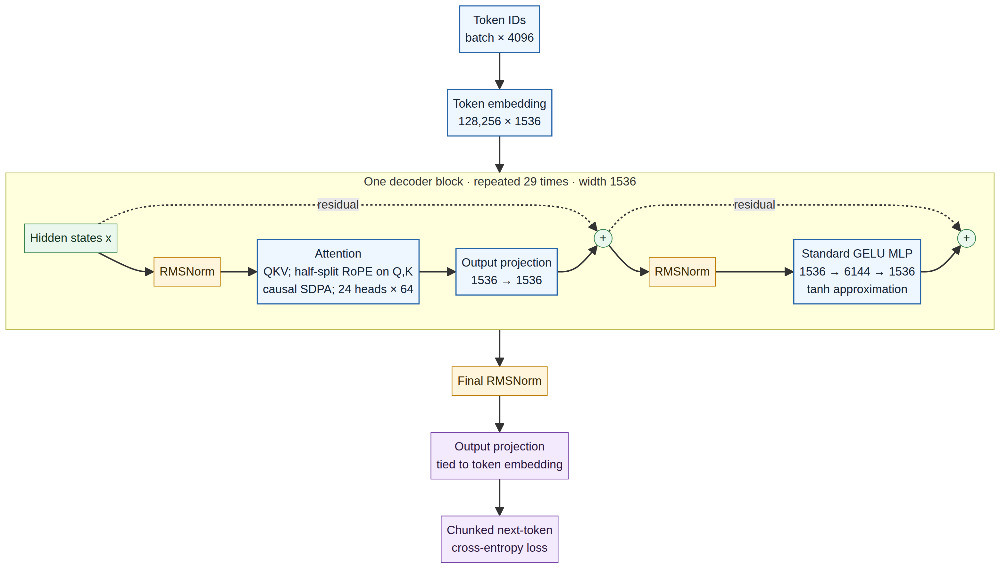
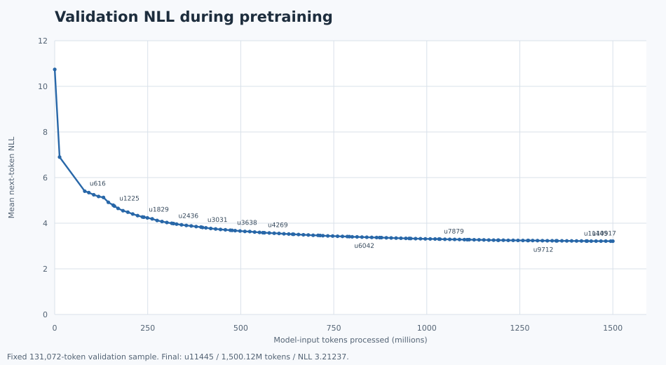

# Pretrain a 1B-Parameter Language Model From Scratch on 2× T4 GPUs


This repository is a **reproducible LLM pretraining recipe and engineering case study** for training a **1B-parameter language model from random initialization** on **2×16GB NVIDIA Tesla T4 GPUs**. The current model has exactly **1,018,126,848 trainable parameters**, uses a 4096-token context, and is pretrained on FineWeb-derived tokens with **PyTorch FSDP `FULL_SHARD`**, gradient accumulation, activation checkpointing, mixed precision, fixed validation, and crash-safe continuation across temporary Kaggle sessions.

If you are looking for **1B LLM pretraining code**, a **PyTorch/FSDP training recipe**, or an end-to-end example of how to **pretrain a language model from scratch on constrained GPUs**, start with **[How to Pretrain a 1B LLM From Scratch on 2× T4 GPUs](docs/PRETRAIN_1B_LLM_FROM_SCRATCH.md)**. It maps the runnable code, FineWeb data preparation, model configuration, token accounting, checkpoint/resume system, validation artifacts, and current training results.

This is an educational case study, not a new training algorithm or architecture, a compute-optimal recipe, or a claim that the resulting model is competitive. Here, “from scratch” means that the **Transformer weights are randomly initialized**; the tokenizer is reused rather than trained in this project. The 1.5B model-input-token target is a training-budget milestone, not a claim that every corpus token is seen exactly once or that downstream capability has been established.

## Start here

| If you want to... | Read / run |
|---|---|
| Understand the complete 1B LLM pretraining recipe | **[1B LLM from-scratch pretraining guide](docs/PRETRAIN_1B_LLM_FROM_SCRATCH.md)** |
| Inspect the exact model architecture and parameter count | [Architecture](docs/01_architecture.md) · [Parameter count](docs/02_parameter_count.md) |
| Understand how 1.018B parameters fit on two 16GB T4s | [Memory and FSDP](docs/03_memory_and_fsdp.md) |
| Reproduce token accounting and optimizer settings | [Batch and tokens](docs/04_batch_and_tokens.md) · [LR and optimizer](docs/05_lr_and_optimizer.md) |
| Run the trainer | [Kaggle launcher](train/launch_kaggle.py) · [Canonical trainer](train/train_1b_dual_t4.py) |
| Prepare FineWeb-derived token shards | [Data preparation](data/prepare_fineweb.md) · [Builder](data/prepare_fineweb.py) |
| Resume safely across Kaggle sessions | [Checkpointing](docs/06_checkpointing.md) · [Resume workflow](docs/07_resume_across_sessions.md) |
| Inspect measured results | [Validation curve](results/validation_curve.csv) · [Milestones](results/milestones.md) · [Plot](results/validation_nll.svg) |
| Load the public model checkpoint | [Anvaya-1B on Hugging Face](https://huggingface.co/Vijayendra/Anvaya-1B) |

## Completed run status

The reference run completed on **20 November 2026** at the configured whole-update token boundary.

| Evidence | Final recorded state |
|---|---|
| Final COMPLETE checkpoint | **Update 11,445 · 1,500,119,040 model-input tokens** |
| Final validation | NLL **3.212374** · perplexity **24.83799** · token accuracy **39.3593%** |
| Fixed validation sample | **131,072 tokens** |
| Latest sampled training telemetry | u11440 · 1,499,463,680 tokens · ~**1,999.55 input tokens/s** |
| Rank-0 PyTorch allocator metric | ~**11.4088 GiB** through the completed continuation |

The final session resumed from **u10917 / 1,430,913,024 tokens**, saved **u11445 / 1,500,119,040 tokens**, evaluated that exact checkpoint, and ended with `[complete] reached training token target`. The model therefore completed the project's configured 1.5B-token training budget rather than stopping at a time guard.

The full fixed-validation ledger, sampled training telemetry, and session-to-session checkpoint chain are in [results](results/README.md).

## What I am training

The model starts with random weights and uses a causal next-token objective on tokenized FineWeb data. The tokenizer is reused; it was not trained as part of this project.

| Setting | Value |
|---|---:|
| Trainable parameters | **1,018,126,848** |
| Transformer blocks | 29 |
| Width | 1536 |
| Attention heads | 24 × 64 dimensions |
| FFN width | 6144 |
| Vocabulary | 128,256 |
| Context | 4096 tokens |
| Attention | Dense causal PyTorch SDPA |
| Normalization / position | RMSNorm / half-split RoPE |

The input and output embeddings share weights. The feed-forward block is a standard two-layer GELU MLP; it is not a gated SwiGLU block. See [the architecture notes](docs/01_architecture.md) and [parameter-count derivation](docs/02_parameter_count.md).



## Hardware and batch size

The run uses two 16 GB NVIDIA Tesla T4 GPUs with PyTorch FSDP `FULL_SHARD`. Each rank processes one 4096-token sequence per microbatch. With 16 accumulation steps, that is:

```text
2 GPUs × 4096 tokens × 16 microbatches = 131,072 input tokens per update
```

The supplied log records a **rank-0 PyTorch allocator high-water mark of 11.4088 GiB** and about **2.1K input tokens/second** through the captured continuation. The memory value is not total device usage or free memory, and it is not a measurement from both ranks. The exact FSDP settings and a derived state-memory estimate are in [memory and FSDP](docs/03_memory_and_fsdp.md).

## Completed validation curve

Validation uses the same 131,072-token sample for every reported event. Selected points are shown below; the full ledger is in [results/validation_curve.csv](results/validation_curve.csv).

| Update | Input tokens | Validation NLL | Perplexity | Token accuracy |
|---:|---:|---:|---:|---:|
| 2 | 262,144 | 10.74244 | 46,279.01 | 3.79% |
| 1,225 | 160,563,200 | 4.75070 | 115.67 | 25.21% |
| 2,436 | 319,291,392 | 3.98411 | 53.74 | 32.38% |
| 4,269 | 559,546,368 | 3.58536 | 36.07 | 35.71% |
| 6,042 | 791,937,024 | 3.41344 | 30.37 | 37.31% |
| 7,879 | 1,032,716,288 | 3.30334 | 27.20 | 38.32% |
| 9,712 | 1,272,971,264 | 3.24208 | 25.59 | 39.05% |
| 10,917 | 1,430,913,024 | 3.21850 | 24.99 | 39.25% |
| **11,445** | **1,500,119,040** | **3.21237** | **24.84** | **39.36%** |



Across the full run, fixed-validation NLL fell from **10.74244 at u2** to **3.21237 at completion**. From the preserved u4269 / 559.55M continuation boundary alone, NLL improved from **3.58536 to 3.21237**, perplexity from **36.07 to 24.84**, and token accuracy from **35.71% to 39.36%**.

These are next-token metrics and do not establish downstream capability.

The existing public Hugging Face release remains the immutable **160M** checkpoint while the later completed checkpoints are prepared as model-only exports. See [checkpoint releases](releases/README.md) for the recommended series.

## Public checkpoint generation verification

The public `160M` Hugging Face artifact has been loaded independently on an NVIDIA L4 and verified end to end. The released package reconstructs **1,018,126,848 parameters**, returns finite logits with shape `[1, 1, 128256]`, and generates recognizable English continuations.

At this early checkpoint, the model already shows local grammar and phrase structure, while factual associations and semantic stability remain weak. For example, open-ended prompts can produce sentence-like prose, but factual prompts such as `The capital of France is` are still unreliable. This is exactly why selected intermediate checkpoints are useful: they let the project observe the emergence of language behavior during pretraining rather than presenting only a final checkpoint.

The current public weights remain the immutable **160M** milestone. The training lineage is now complete at **1.500119B model-input tokens**, and later revisions should be published only after each model-only export is load-tested.

## Early behavioral comparison with Pythia-1B

I also ran a frozen generation suite against **EleutherAI/pythia-1b**, whose **1,011,781,632 parameters** make it an unusually close scale reference for Anvaya's **1,018,126,848** parameters.

The first comparison brackets Anvaya's current token exposure:

| Model | Approx. tokens | Optimizer updates |
|---|---:|---:|
| Pythia-1B step64 | 134.2M | 64 |
| **Anvaya-1B 160M** | **160.56M** | **1,225** |
| Pythia-1B step128 | 268.4M | 128 |

Under the same prompt suite, Anvaya at 160.56M tokens is already substantially more sentence-like than the tested Pythia step64 and step128 checkpoints. That is an interesting behavioral observation, **not an architecture-superiority claim**: Pythia uses a much larger global batch and its early checkpoints are still near the beginning of a 1% warmup over 143,000 iterations, while Anvaya uses a 75-update warmup and many more optimizer updates per comparable token exposure.

The full comparison, example generations, training-schedule caveats, and the proposed distinction between **token-matched** and **update-matched** comparisons are documented in **[Anvaya-1B vs Pythia-1B at early training](research/anvaya_vs_pythia_early_training.md)**.

## How the run continues across Kaggle sessions

Kaggle sessions are temporary, and a full FSDP checkpoint is large. The trainer resumes only from a two-rank checkpoint with a `complete.json` marker. It writes rank files to temporary names, renames them when serialization finishes, and creates the marker after both ranks synchronize. A mounted parent checkpoint remains untouched while the next session writes its output.

The first long run failed during a checkpoint save after update 100. That was a storage failure, not a training-loss failure. The current continuation design came out of that experience. More detail is in [checkpointing](docs/06_checkpointing.md) and [failure notes](docs/08_failure_modes.md).

## Try the recipe

The intended environment is a Kaggle notebook with **GPU T4 ×2** and the FineWeb-D1 token dataset attached. The corpus is external to this repository, and the Meta tokenizer may require accepting its license and authenticating with Hugging Face.

From a copy of the repository in `/kaggle/working`, run:

```bash
python train/launch_kaggle.py
```

The launcher reads `train/config_1b_t4.json`. For continuation, attach the output containing a complete checkpoint. With `resume_from` empty, the trainer searches mounted Kaggle inputs for a compatible checkpoint. The detailed setup and data contract are in [`data/prepare_fineweb.md`](data/prepare_fineweb.md) and [`docs/07_resume_across_sessions.md`](docs/07_resume_across_sessions.md).

A new stream rebuild follows the documented dataset contract; it is not guaranteed to reproduce the historical token files byte for byte. Exact continuation requires the original token shards and tokenizer files.

## Token budget and sampling

The configured target was **1.5 billion model-input tokens**. Because training stops on a whole optimizer update, the final boundary was 11,445 updates, or **1,500,119,040 input tokens**. That boundary has now been reached. The trainer samples deterministic 4096-token windows from individual training shards with replacement, so the token ledger is not a claim that every corpus token was seen exactly once.

## What “from scratch” means here

The Transformer parameters are randomly initialized. No pretrained Transformer weights are loaded. I reuse the Llama 3.2 1B tokenizer, and the training corpus is prepared in advance. The tokenizer’s provenance and historical hashes are documented separately.

## Related projects

This project borrows the step-by-step spirit of [build-nanogpt](https://github.com/karpathy/build-nanogpt), but tackles the systems issues that appear when the model no longer fits as a replicated job. It is not a performance comparison with [TinyLlama](https://github.com/jzhang38/TinyLlama), which trained at a much larger token and hardware scale. [LitGPT](https://github.com/Lightning-AI/litgpt) is a useful reference for runnable training instructions; [OLMo](https://allenai.org/olmo) is a much broader example of an open model lifecycle.

## License

The MIT license in this repository covers the original code and documentation here. FineWeb and the tokenizer have their own terms; see [the source notes](research/SOURCES.md) before redistributing data or derived artifacts.
