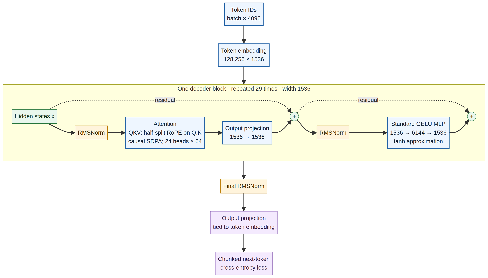
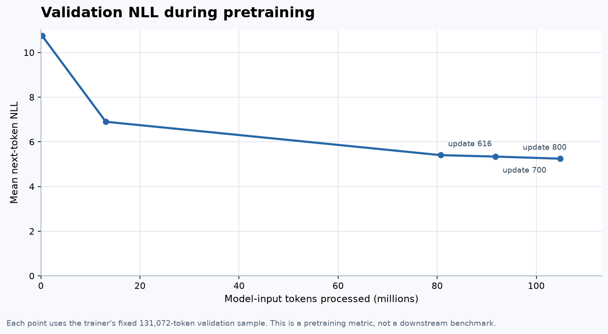

# Pretrain a 1B-Parameter Language Model From Scratch on 2× T4 GPUs

## What this project is—and isn’t

This repository documents a real pretraining experiment: a 1,018,126,848-parameter dense decoder-only Transformer, randomly initialized and trained on FineWeb-derived tokens using two 16GB NVIDIA Tesla T4 GPUs. The focus is the engineering around running a model at this size in a constrained, temporary environment: FSDP sharding, memory and token accounting, validation, checkpointing, and continuation across Kaggle sessions.

This is an educational case study, not a new training algorithm or architecture, a compute-optimal recipe, or a claim that the resulting model is competitive. The tokenizer is reused, not trained here. The 1.5B input-token target is a training-budget milestone; it does not mean every corpus token is seen once or establish downstream capability. The repository separates recorded measurements from assumptions and work still to be done.

## Live run status

The latest run snapshot supplied for this repository update is from **5 November 2026**; it is not a real-time status feed.

| Evidence | Latest recorded state |
|---|---|
| Training log | Update **1070** · **140,247,040** model-input tokens · **2,133.15** input tokens/second at that update |
| PyTorch memory metric | Rank-0 allocator high-water mark **11.4088 GiB** through the captured continuation; see [memory and FSDP details](docs/03_memory_and_fsdp.md) |
| Validation | Update **1000** · **131,072,000** model-input tokens · NLL **5.12850** · perplexity **168.76** · token accuracy **22.94%** on **131,072** validation tokens |
| Last complete parent checkpoint | Update **616** · **80,740,352** model-input tokens |

Update 1070 is a training-log observation, not a documented complete checkpoint. The latest captured validation is update 1000. The run has crossed the 100M-token analytical milestone, but these records do not establish whether the job is still running now or whether a later checkpoint has been saved.

The live trainer copy supplied with this run and the repository trainer `train/train_1b_dual_t4.py` match byte-for-byte (SHA-256: `55a57185b100a8f63f1e3b77c5fd80726b952c8abe49b0a06f9aa5af5a83f440`).

## What I am training

The model starts with random weights and uses a causal next-token objective on tokenized FineWeb data. The tokenizer is reused; it was not trained as part of this project.

| Setting | Value |
|---|---:|
| Trainable parameters | **1,018,126,848** |
| Transformer blocks | 29 |
| Width | 1536 |
| Attention heads | 24 × 64 dimensions |
| FFN width | 6144 |
| Vocabulary | 128,256 |
| Context | 4096 tokens |
| Attention | Dense causal PyTorch SDPA |
| Normalization / position | RMSNorm / half-split RoPE |

The input and output embeddings share weights. The feed-forward block is a standard two-layer GELU MLP; it is not a gated SwiGLU block. See [the architecture notes](docs/01_architecture.md) and [parameter-count derivation](docs/02_parameter_count.md).



## Hardware and batch size

The run uses two 16 GB NVIDIA Tesla T4 GPUs with PyTorch FSDP `FULL_SHARD`. Each rank processes one 4096-token sequence per microbatch. With 16 accumulation steps, that is:

```text
2 GPUs × 4096 tokens × 16 microbatches = 131,072 input tokens per update
```

The supplied log records a **rank-0 PyTorch allocator high-water mark of 11.4088 GiB** and about **2.1K input tokens/second** through the captured continuation. The memory value is not total device usage or free memory, and it is not a measurement from both ranks. The exact FSDP settings and a derived state-memory estimate are in [memory and FSDP](docs/03_memory_and_fsdp.md).

## Validation so far

Validation uses the same 131,072-token sample for each reported event. The table shows the update and actual number of model-input tokens processed at that point; it does not imply that every token in the training corpus has been seen exactly once.

| Update | Input tokens | Validation NLL | Perplexity | Token accuracy |
|---:|---:|---:|---:|---:|
| 2 | 262,144 | 10.74244 | 46,279.01 | 3.79% |
| 100 | 13,107,200 | 6.89855 | 990.83 | 12.09% |
| 616 | 80,740,352 | 5.40386 | 222.26 | 21.15% |
| 700 | 91,750,400 | 5.34038 | 208.59 | 21.51% |
| 800 | 104,857,600 | 5.24585 | 189.78 | 22.05% |
| 900 | 117,964,800 | 5.17369 | 176.57 | 22.52% |
| 1000 | 131,072,000 | 5.12850 | 168.76 | 22.94% |



The curve is moving in the expected direction, but these are next-token metrics on one validation sample. They do not establish downstream capability. I have not yet run a fixed benchmark suite or released model weights.

## How the run continues across Kaggle sessions

Kaggle sessions are temporary, and a full FSDP checkpoint is large. The trainer resumes only from a two-rank checkpoint with a `complete.json` marker. It writes rank files to temporary names, renames them when serialization finishes, and creates the marker after both ranks synchronize. A mounted parent checkpoint remains untouched while the next session writes its output.

The first long run failed during a checkpoint save after update 100. That was a storage failure, not a training-loss failure. The current continuation design came out of that experience. More detail is in [checkpointing](docs/06_checkpointing.md) and [failure notes](docs/08_failure_modes.md).

## Try the recipe

The intended environment is a Kaggle notebook with **GPU T4 ×2** and the FineWeb-D1 token dataset attached. The corpus is external to this repository, and the Meta tokenizer may require accepting its license and authenticating with Hugging Face.

From a copy of the repository in `/kaggle/working`, run:

```bash
python train/launch_kaggle.py
```

The launcher reads `train/config_1b_t4.json`. For continuation, attach the output containing a complete checkpoint. With `resume_from` empty, the trainer searches mounted Kaggle inputs for a compatible checkpoint. The detailed setup and data contract are in [`data/prepare_fineweb.md`](data/prepare_fineweb.md) and [`docs/07_resume_across_sessions.md`](docs/07_resume_across_sessions.md).

A new stream rebuild follows the documented dataset contract; it is not guaranteed to reproduce the historical token files byte for byte. Exact continuation requires the original token shards and tokenizer files.

## Token budget and sampling

The nominal target is **1.5 billion model-input tokens**. The trainer samples deterministic 4096-token windows from individual training shards. It samples with replacement, so “1.5B tokens” is an update ledger, not a promise of one exact pass over all 1.485B corpus tokens. With whole updates, the run’s configured target is 11,445 updates, or **1,500,119,040** input tokens.

## What “from scratch” means here

The Transformer parameters are randomly initialized. No pretrained Transformer weights are loaded. I reuse the Llama 3.2 1B tokenizer, and the training corpus is prepared in advance. The tokenizer’s provenance and historical hashes are documented separately.

## Related projects

This project borrows the step-by-step spirit of [build-nanogpt](https://github.com/karpathy/build-nanogpt), but tackles the systems issues that appear when the model no longer fits as a replicated job. It is not a performance comparison with [TinyLlama](https://github.com/jzhang38/TinyLlama), which trained at a much larger token and hardware scale. [LitGPT](https://github.com/Lightning-AI/litgpt) is a useful reference for runnable training instructions; [OLMo](https://allenai.org/olmo) is a much broader example of an open model lifecycle.

## License

The MIT license in this repository covers the original code and documentation here. FineWeb and the tokenizer have their own terms; see [the source notes](research/SOURCES.md) before redistributing data or derived artifacts.
