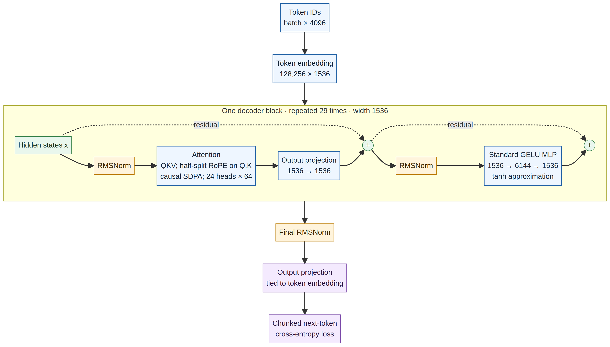

# Model architecture

The trainer builds a decoder-only Transformer from random weights. I kept the block conventional on purpose: the systems problem here is fitting and continuing a 1B-scale run on two T4s, not testing a new attention variant.



The diagram shows one block; the model repeats it 29 times.

| Property | Value |
|---|---:|
| Trainable parameters | 1,018,126,848 |
| Transformer blocks | 29 |
| Hidden width | 1536 |
| Attention heads | 24 |
| Head dimension | 64 |
| FFN width | 6144 |
| Vocabulary | 128,256 |
| Training context | 4096 tokens |

## One block

For a hidden-state sequence `x`, each block applies two pre-normalized residual branches:

```text
h = x + Attention(RMSNorm(x))
y = h + W₂(GELU(W₁(RMSNorm(h))))
```

The attention projection produces Q, K, and V. Rotary position information is applied to Q and K using the half-split implementation in the trainer, then PyTorch SDPA computes dense causal attention. The feed-forward network is two bias-free linear layers, `1536 → 6144 → 1536`, with GELU using PyTorch's `tanh` approximation. There is no gate in this MLP.

After the final block, an RMSNorm is applied. The token embedding matrix is also used as the output projection, so the input embedding and language-model head share one parameter matrix. To limit memory use, the trainer computes the full-vocabulary loss in chunks of 128 token positions.

## Scope

The architecture description is tied to `train/train_1b_dual_t4.py`. If that implementation changes, this page and the diagram should change with it. The exact parameter arithmetic is in [parameter count](02_parameter_count.md).
