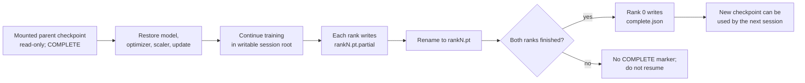

# Checkpoints and session boundaries

A Kaggle session can end while training is healthy. The checkpoint logic is designed to leave a clear answer to one question: is this directory safe to resume from?

The trainer accepts a checkpoint only when it contains both rank files and a `complete.json` marker. Each rank writes to `rankN.pt.partial` first and renames the file after serialization. Rank 0 writes the marker only after both ranks have synchronized.

If the session stops before the marker is written, the new directory is ignored. The mounted parent remains unchanged and can still be used for the next attempt. After a new complete checkpoint is written, the trainer may remove older complete checkpoints under its writable output root; it does not delete the mounted parent.

The first long run failed while writing a multi-gigabyte checkpoint. It left partial files but no completion marker. The current rule is deliberately simple: partial files are evidence of an interrupted save, not a usable checkpoint.
