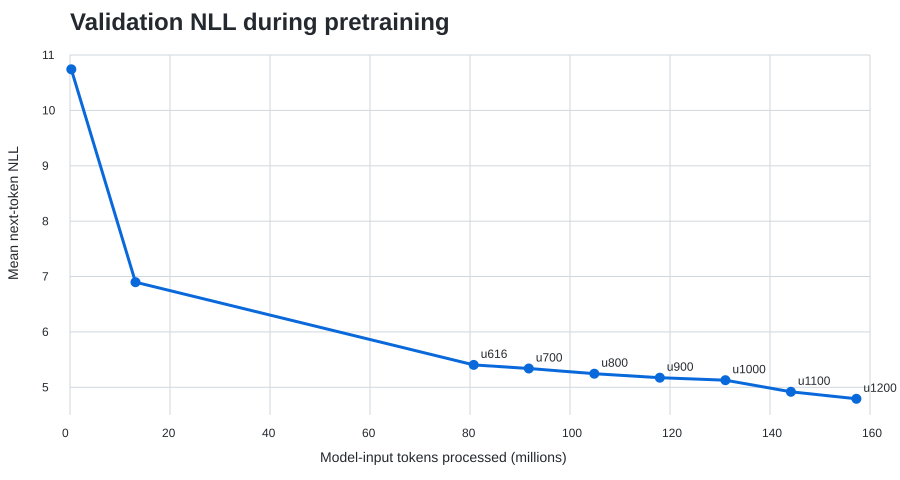

# How to Pretrain a 1B LLM From Scratch on 2× T4 GPUs

This guide is the shortest path through the repository for someone looking for a **1B LLM pretraining recipe**, **language-model pretraining code**, or a concrete example of training a billion-parameter Transformer on constrained GPUs.

The experiment trains a **1,018,126,848-parameter dense decoder-only language model** from random Transformer initialization using **2×16GB NVIDIA Tesla T4 GPUs**, **PyTorch FSDP `FULL_SHARD`**, a **4096-token context**, FineWeb-derived token shards, gradient accumulation, activation checkpointing, mixed precision, fixed validation, and crash-safe continuation across Kaggle sessions.

> **What “from scratch” means here:** no pretrained Transformer weights are loaded. The model parameters start from random initialization. The tokenizer is reused from the Llama 3.2 1B tokenizer family rather than trained as part of this project.

This is an educational and reproducibility-focused training recipe. It is not presented as a compute-optimal way to train a competitive 1B foundation model.

## What is included

The repository contains the complete path needed to inspect or reproduce the experiment:

| Part of the recipe | Repository artifact |
|---|---|
| Exact 1.018B architecture | [Architecture](01_architecture.md) |
| Parameter-count derivation | [Parameter count](02_parameter_count.md) |
| PyTorch FSDP memory strategy | [Memory and FSDP](03_memory_and_fsdp.md) |
| Global batch and token ledger | [Batch and token accounting](04_batch_and_tokens.md) |
| AdamW and learning-rate schedule | [LR and optimizer](05_lr_and_optimizer.md) |
| Crash-safe distributed checkpoints | [Checkpointing](06_checkpointing.md) |
| Kaggle session-to-session continuation | [Resume workflow](07_resume_across_sessions.md) |
| Failure modes encountered in the real run | [Failure notes](08_failure_modes.md) |
| FineWeb-derived data preparation | [Data preparation](../data/prepare_fineweb.md) |
| Canonical training code | [train_1b_dual_t4.py](../train/train_1b_dual_t4.py) |
| Kaggle launcher | [launch_kaggle.py](../train/launch_kaggle.py) |
| Exact training configuration | [config_1b_t4.json](../train/config_1b_t4.json) |
| Fixed validation ledger | [validation_curve.csv](../results/validation_curve.csv) |
| Training-log samples | [training_curve.csv](../results/training_curve.csv) |
| Current milestones | [milestones.md](../results/milestones.md) |

## Model configuration

The model is intentionally conventional so that the systems work remains easy to study.

| Setting | Value |
|---|---:|
| Trainable parameters | **1,018,126,848** |
| Transformer blocks | 29 |
| Width | 1536 |
| Attention heads | 24 |
| Head dimension | 64 |
| FFN width | 6144 |
| Vocabulary | 128,256 |
| Context length | 4096 |
| Attention | Dense causal PyTorch SDPA |
| Normalization | RMSNorm |
| Position encoding | RoPE |
| MLP | Two-layer GELU |
| Embeddings | Input/output weights tied |

The architecture is described in more detail in [01_architecture.md](01_architecture.md).

## Why FSDP is required on two T4s

A billion-parameter model is not difficult only because of parameter storage. Training also requires gradients, AdamW optimizer states, mixed-precision working tensors, activations, attention and MLP intermediates, communication buffers, and framework overhead.

This recipe therefore uses **PyTorch Fully Sharded Data Parallel (FSDP) with `FULL_SHARD`** across the two T4 GPUs. Model parameters, gradients, and optimizer state are sharded rather than fully replicated. Activation checkpointing reduces activation memory further.

The recorded rank-0 PyTorch allocator high-water mark through the current continuation is approximately **11.41 GiB**. See [memory and FSDP](03_memory_and_fsdp.md) for the exact interpretation and accounting caveats.

## Global batch and token accounting

Each GPU rank processes one 4096-token sequence per microbatch, and gradients are accumulated for 16 microbatches:

```text
4096 tokens × 2 GPU ranks × 16 accumulation steps
= 131,072 model-input tokens per optimizer update
```

This value is the ledger used throughout the project. At optimizer update `u`:

```text
model-input tokens = u × 131,072
```

The nominal target is 1.5B model-input tokens. Because training stops on a whole optimizer update, the configured final boundary is **11,445 updates / 1,500,119,040 input tokens**.

The sampler draws deterministic windows with replacement. The token ledger therefore measures input processed by the model; it is not a claim that every corpus token is visited exactly once.

## Data: FineWeb-derived token shards

The historical run uses data derived from Hugging Face FineWeb, configuration `CC-MAIN-2025-26`, tokenized into little-endian uint32 shards.

The historical data contract records approximately:

- **1.485B training tokens**
- **15M validation tokens**
- **24 training shards**
- vocabulary size **128,256**

A fresh rebuild can follow the same documented data contract but is not automatically guaranteed to be byte-identical to the historical token files. Start with [data/prepare_fineweb.md](../data/prepare_fineweb.md) and [data/prepare_fineweb.py](../data/prepare_fineweb.py).

## Run the 1B pretraining code

The intended reference environment is a Kaggle notebook with **GPU T4 ×2** and the FineWeb token dataset attached.

The canonical launcher is:

```bash
python train/launch_kaggle.py
```

The launcher reads [train/config_1b_t4.json](../train/config_1b_t4.json) and starts the canonical trainer at [train/train_1b_dual_t4.py](../train/train_1b_dual_t4.py).

For a fresh run, the trainer initializes the Transformer parameters randomly. For a continuation, it can discover and restore a compatible COMPLETE two-rank checkpoint from mounted Kaggle inputs.

## Crash-safe checkpoint and resume design

Temporary notebook sessions are a serious constraint when pretraining a 1B model. The first long experiment encountered a checkpoint-save storage failure even though training itself remained healthy.

The current protocol is transactional:

1. each rank writes a temporary `rankN.pt.partial` file;
2. a rank file is renamed only after serialization completes;
3. both ranks synchronize;
4. rank 0 writes `complete.json`;
5. only directories with both expected rank files and the completion marker are eligible parents.

The mounted parent checkpoint stays immutable while a new session writes a child checkpoint. An interrupted save therefore does not corrupt the last known-good training state.

See [checkpointing](06_checkpointing.md) and [resume across sessions](07_resume_across_sessions.md).

## Current measured training state

As of the completed **8 November 2026** session:

| Frontier | Latest recorded state |
|---|---|
| Sampled training log | **u4870 / 638,320,640 input tokens** |
| Fixed validation | **u4800 / 629,145,600 input tokens** |
| Validation NLL | **3.52762** |
| Validation perplexity | **34.04** |
| Validation token accuracy | **36.17%** |
| Latest COMPLETE checkpoint | **u4879 / 639,500,288 input tokens** |
| Public Hugging Face weights | **Anvaya-1B `160M` / u1225 / 160,563,200 tokens** |

The training lineage has crossed **600M model-input tokens**. The later u4879 state is a resumable training checkpoint, while the currently public Hugging Face weights intentionally remain the earlier immutable `160M` milestone.



These are next-token measurements on a fixed 131,072-token validation sample. They are not downstream benchmark scores.

## Public model: Anvaya-1B

The public model artifact is available at [Vijayendra/Anvaya-1B](https://huggingface.co/Vijayendra/Anvaya-1B).

The current public revision is the early `160M` checkpoint. It is useful as a preserved view of language behavior during early pretraining, not as a claim of a fully trained or competitive 1B model.

## What this recipe is useful for

This project is most relevant if you want to study or reproduce:

- **1B LLM pretraining from scratch**
- **PyTorch FSDP pretraining**
- **LLM training on two 16GB GPUs**
- **FineWeb language-model pretraining**
- **Kaggle T4 distributed training**
- **activation checkpointing and gradient accumulation at 1B scale**
- **distributed checkpoint/resume across temporary GPU sessions**
- **token accounting and fixed validation during pretraining**

The aim is not to hide the hard parts behind a large cluster. It is to make the engineering path inspectable.

## What this recipe does not claim

The repository does **not** claim:

- that 1.5B tokens is compute-optimal for a 1B model;
- that two T4 GPUs are the fastest or most economical production setup;
- that the architecture is novel;
- that current next-token validation establishes downstream capability;
- that the public 160M checkpoint is a finished foundation model.

The project is a documented, real training run and an educational pretraining systems recipe.

## Suggested reading order

For the fastest technical understanding:

1. [Architecture](01_architecture.md)
2. [Memory and FSDP](03_memory_and_fsdp.md)
3. [Batch and token accounting](04_batch_and_tokens.md)
4. [LR and optimizer](05_lr_and_optimizer.md)
5. [Checkpointing](06_checkpointing.md)
6. [Resume workflow](07_resume_across_sessions.md)
7. [Canonical trainer](../train/train_1b_dual_t4.py)
8. [Results and milestones](../results/milestones.md)

For the broader engineering narrative, read [Pretraining a 1B-Parameter Language Model From Scratch on Two T4 GPUs](../research/launch/ARTICLE_V1.md).
